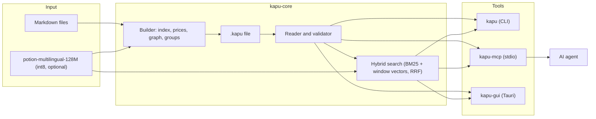

<div align="center">


# KAPU

**One text file your AI agent reads like a building plan: it looks at the map, searches, and opens only the rooms it needs.**


[Results](#results) · [Quickstart](#quickstart) · [Claude Code](#use-it-from-claude-code) · [How it works](#how-it-works) · [Magyar](#magyar)

</div>

<p align="center">
  
</p>

> On a 207,000-token manual the model had never seen, Claude agents using KAPU answered **12 of 12** beginner questions while reading **4,104 tokens** per question: **half** of what the same agents read with grep over the Markdown file, and **2%** of pasting the whole manual into the context.

## Results

The same 12 questions about the PixelLab documentation (third-party, not published), the same prompt for every format, three blind judges checking every claim against the documentation:

| How the agent got the knowledge | Tokens read per question (median) | Correct of 12 |
|---|---:|---:|
| **KAPU** (map, search, open) | **4,104** | **12** |
| One Markdown file, grep and line reads | 8,280 | 12 |
| The same text as a PDF, search and page reads | 8,207 | 11 |
| The whole file pasted into the context | 206,899 | – |

On public documentation with real Stack Overflow questions (format 1.1, one Windows 11 machine, release build):

| Corpus | Knowledge | `.kapu` file | Search | Open a section | Retrieval: KAPU / chunked BM25 |
|---|---:|---:|---:|---:|---:|
| Rust book | 0.3 M tokens | 2.2 MB | 13 ms | 2 ms | 0.49 / 0.49 |
| Kubernetes docs | 3.9 M tokens | 26 MB | 19 ms | 5 ms | 0.46 / 0.45 |
| MDN Web Docs | 13.0 M tokens | 128 MB | 158 ms | 44 ms | 0.27 / 0.30 |

Retrieval is room-level recall@10: the page the accepted answer links to is among the first 10 hits. Times are medians over the MCP server. Full results with charts, method and limits: **[results page](https://piszabolcs.github.io/kapu/results/)** ([source](docs/results/index.html)) and [bench/RESULTS.md](bench/RESULTS.md); raw numbers in [bench/results/](bench/results/).

## Why

AI agents get their working knowledge as Markdown: a manual, a specification, a library of skills, project notes. Pasting all of it costs tokens on every turn and pushes the useful part out of the context window. A vector database needs a server and an embedding service, cuts the text into chunks and loses the structure. Many small files lose the overview, and the agent has to guess which one to read.

KAPU keeps the Markdown as it is and adds, in the same file, a map of every section with its token price, a search index, a graph of related sections and fingerprints. The agent sees the table of contents first and pays only for what it opens.

| | A folder of Markdown | Vector database / RAG | KAPU |
|---|---|---|---|
| What you run | nothing | a database and an embedding service | one binary; the 124 MB embedding model is optional and offline |
| What the agent sees first | file names | nothing until it queries | a map with every section and its token price |
| What the agent reads | whole files, or grep lines without context | chunks cut at a fixed size | whole sections it picks |
| Structure | files and headings | lost in the chunks | rooms, sections, links and topic groups |
| In git | yes | no, a binary index | yes: one UTF-8 text file, byte-identical rebuilds |

## Quickstart

Build from source with [Rust](https://rustup.rs) (the toolchain is pinned in `rust-toolchain.toml`):

```bash
git clone https://github.com/piszabolcs/kapu.git
cd kapu
cargo build --release -p kapu-cli -p kapu-mcp
```

Look around in the example, which is this project's own documentation as a KAPU file:

```bash
target/release/kapu map examples/kapu-docs.kapu
target/release/kapu search examples/kapu-docs.kapu "how do I connect it to Claude Code" --k 3
target/release/kapu open examples/kapu-docs.kapu overview/use-it-from-claude-code
```

Make your own from a folder of Markdown files (one room per file, `##` headings become sections):

```bash
target/release/kapu import ./my-notes notes.kapu
```

Search by meaning is optional. For it, download [`minishlab/potion-multilingual-128M`](https://huggingface.co/minishlab/potion-multilingual-128M) (`config.json`, `README.md`, `tokenizer.json`, `model.safetensors`) into `models/potion-multilingual-128M` and make the int8 copy the tools look for: `python tools/quantize.py models/potion-multilingual-128M`. Without it, keyword search (BM25) still works.

## Use it from Claude Code

```bash
claude mcp add kapu -- /path/to/kapu-mcp
```

Then ask, for example: "Use `notes.kapu` to answer: how do we deploy the staging server?" The server gives the agent five tools:

| Tool | What it returns |
|---|---|
| `kapu_map` | the map: groups, rooms and their token prices, the content language, a short guide on first use |
| `kapu_search` | the best sections for a query, each with its price and the line that matched |
| `kapu_describe` | the description and tags of a section, without opening it |
| `kapu_open` | the text of a section, framed so it cannot pose as instructions; long sections in parts |
| `kapu_write` | adds a room from Markdown, rebuilds the file and reports what the content scan found |

For Claude Desktop or another MCP client, start `kapu-mcp` over stdio; `KAPU_MODEL_DIR` points it at the model folder. Keep the `.kapu` file outside the agent's working directory if you want it to use the tools instead of reading the file directly.

## How it works

A `.kapu` file is plain UTF-8 text. The Markdown body is the single source of truth; every other section is rebuilt from it, byte for byte, by `kapu build`.

```text
%KAPU 1.1          512-byte header: where each section starts, fingerprints, counts
#MAP    ... #END   groups and doors (rooms and their sections) with token prices
#DESC   ... #END   one-line descriptions and tags
#GRAPH  ... #END   links, shared rare terms and similar meaning between doors
#INDEX  ... #END   BM25 index; postings are positions in #DOCS, not ids
#DOCS   ... #END   byte offset, length, BLAKE3 fingerprint and word count of every door
#BODY              the Markdown rooms, one after the other
```

- **Map first.** Even for 13 million tokens of documentation the map is about 2,000 tokens: groups (Leiden clusters named by their keywords) and their rooms with prices.
- **Hybrid search.** BM25 with English and Hungarian stemming, plus a static multilingual embedding model with one vector per 512-token window of a section, merged with reciprocal rank fusion.
- **Opening is a seek.** The reader jumps to the byte offset in `#DOCS`, checks the section's fingerprint and returns its text. A section longer than 2,000 tokens comes in parts.
- **Edits stay safe.** If someone edits the body by hand, the fingerprints no longer match; the reader notices, rebuilds the positions from the room markers and reports a stale index until the next build.
- **Content scan.** Writing a room warns about text that tries to override an agent's instructions, hidden characters, long encoded blocks and unexpected download commands. It warns, it does not block.

The format is specified in [SPEC-KAPU.md](SPEC-KAPU.md) (in Hungarian for now), with test vectors for every error code in [tests/vectors](tests/vectors) and a byte-level Python reference builder in [tools/build_vectors.py](tools/build_vectors.py).

## Desktop window

`kapu-gui` shows a file the way an agent sees it: map, rooms, search, graph and checks.

<table>
  <tr>
    <td align="center" width="50%"><br/><sub>Map, an open room and its neighbours</sub></td>
    <td align="center" width="50%"><br/><sub>Hybrid search with a running token total</sub></td>
  </tr>
  <tr>
    <td align="center" width="50%"><br/><sub>Graph of the doors, coloured by group</sub></td>
    <td align="center" width="50%"><br/><sub>Full check: fingerprints and a byte-for-byte rebuild</sub></td>
  </tr>
</table>

```bash
cargo build --release -p kapu-gui
target/release/kapu-gui examples/kapu-docs.kapu
```

On Linux the window needs WebKitGTK: `sudo apt install libwebkit2gtk-4.1-dev libxdo-dev libssl-dev librsvg2-dev`.

## Architecture



| Layer | Technology |
|---|---|
| Language | Rust 1.99 (edition 2024), no `unsafe` |
| File format | UTF-8 text, 512-byte header, BLAKE3 fingerprints, token prices with `tiktoken-rs` (o200k_base) |
| Search | BM25 with Snowball stemming (`rust-stemmers`), Model2Vec static embeddings (`tokenizers`, safetensors), RRF |
| Graph and groups | `link`, `term` and `sim` edges, own Leiden implementation (checked against `leidenalg`), YAKE group names |
| Agent interface | MCP over stdio with `rmcp` |
| Command line and window | `clap` 4; Tauri 2 with plain HTML, CSS and JavaScript |
| Quality | clippy pedantic, cargo-deny, cargo-audit, cargo-fuzz, CI on Windows, Linux and macOS, a byte-level Python reference builder |

## Project structure

```text
kapu/
├── crates/
│   ├── kapu-core/    format, builder, reader, validator, search, graph, groups
│   ├── kapu-cli/     the `kapu` command line tool
│   ├── kapu-mcp/     the `kapu-mcp` MCP server (stdio)
│   ├── kapu-gui/     the `kapu-gui` desktop window (Tauri, ui/ is the interface)
│   └── kapu-bench/   synthetic corpus generator and measurements
├── examples/         kapu-docs.kapu (this documentation), kapu-spec.kapu (the specification)
├── tests/            test vectors, one file per error code; the tiny test model
├── bench/            RESULTS.md and the raw results as JSON
├── docs/             results page, logo, screenshots, demo
├── fuzz/             cargo-fuzz targets
├── tools/            Python reference builder, quantizer, measurement scripts
└── scripts/          check, fuzz and package scripts
```

## Status

KAPU is a working pre-release: the format, the command line, the MCP server and the Windows window are in daily use; the measurements above are a pilot, not a benchmark.

- [ ] Prebuilt binaries for Windows, Linux and macOS from the release workflow
- [ ] The specification in English
- [ ] Paging for the room list of very large groups (13M-token corpora)
- [ ] Better search when the question and the text are in different languages
- [ ] The desktop window tested by hand on Linux and macOS

## License

Code: MIT, see [LICENSE](LICENSE). Specification (`SPEC-KAPU.md`): CC BY 4.0. Fonts in `crates/kapu-gui/ui/fonts`: SIL Open Font License 1.1. Third-party crates and the model: [THIRD-PARTY.md](THIRD-PARTY.md).

---

## Magyar

**Egyetlen szövegfájl, amelyet az AI ügynök alaprajzként olvas: megnézi a térképet, keres, és csak azokat a szobákat nyitja ki, amelyekre szüksége van.**

Egy 207 ezer tokenes, a modell számára ismeretlen kézikönyvön a KAPU-t használó Claude-ügynökök a 12 kezdő kérdésből 12-re helyesen válaszoltak, kérdésenként mediánban 4 104 token elolvasásával. Ez fele annak, amit ugyanezek az ügynökök a Markdown-fájlban greppel kereséssel olvastak, és 2%-a annak, mintha az egész kézikönyvet bemásolnánk a kontextusba.

| Honnan kapta az ügynök a tudást | Olvasott token/kérdés (medián) | Helyes a 12-ből |
|---|---:|---:|
| **KAPU** (térkép, keresés, kinyitás) | **4 104** | **12** |
| Egy Markdown-fájl, grep és sorolvasás | 8 280 | 12 |
| Ugyanez PDF-ként, keresés és oldalolvasás | 8 207 | 11 |
| Az egész fájl bemásolva | 206 899 | – |

A nyilvános dokumentációkon (Rust Book, Kubernetes, MDN) a keresés 13–158 ms, egy fejezet kinyitása 2–44 ms; a visszakeresés a két kisebb korpuszon a darabolós BM25 szintjén vagy fölötte van, a legnagyobbon kicsit alatta. A teljes eredmény diagramokkal, angolul és magyarul: **[eredményoldal](https://piszabolcs.github.io/kapu/results/)**.

**Kipróbálás:** `cargo build --release -p kapu-cli -p kapu-mcp`, majd `target/release/kapu map examples/kapu-docs.kapu`. Saját fájl egy Markdown-mappából: `kapu import ./jegyzetek jegyzetek.kapu`. Claude Code-hoz: `claude mcp add kapu -- /path/to/kapu-mcp`.

**Hogyan működik:** a `.kapu` fájl sima UTF-8 szöveg. A Markdown törzs az egyetlen igazságforrás; a térkép a tokenárakkal, a keresőindex, a gráf és az ujjlenyomatok bájtra azonosan újraépülnek belőle. A formátum specifikációja: [SPEC-KAPU.md](SPEC-KAPU.md).

**Licenc:** a kód MIT, a specifikáció CC BY 4.0.

---

<div align="center">
<sub>Built by Szabolcs Pintér with Claude as co-author · <a href="https://github.com/piszabolcs">GitHub</a> · <a href="https://www.linkedin.com/in/piszabolcs">LinkedIn</a></sub>
</div>
