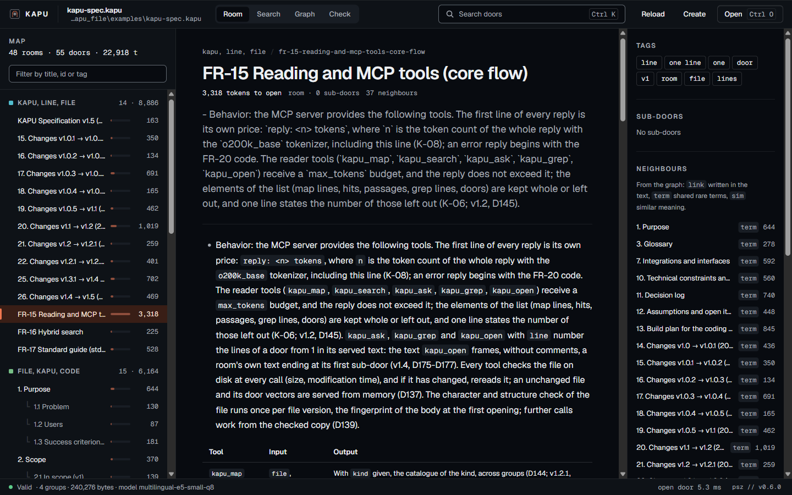
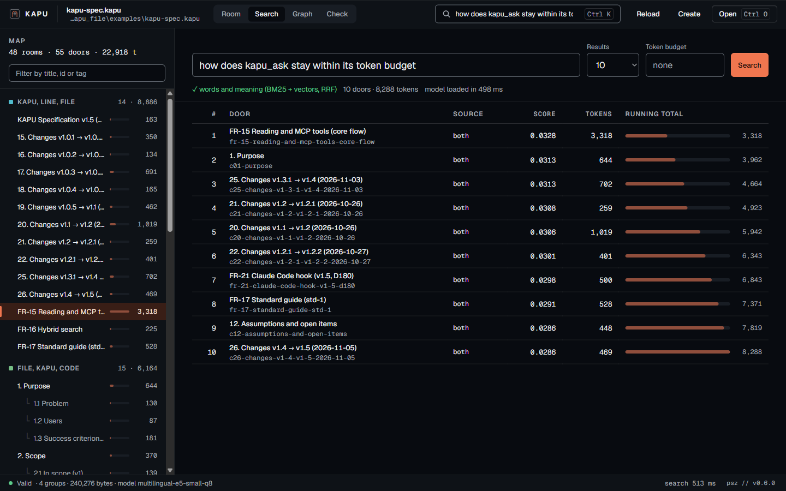
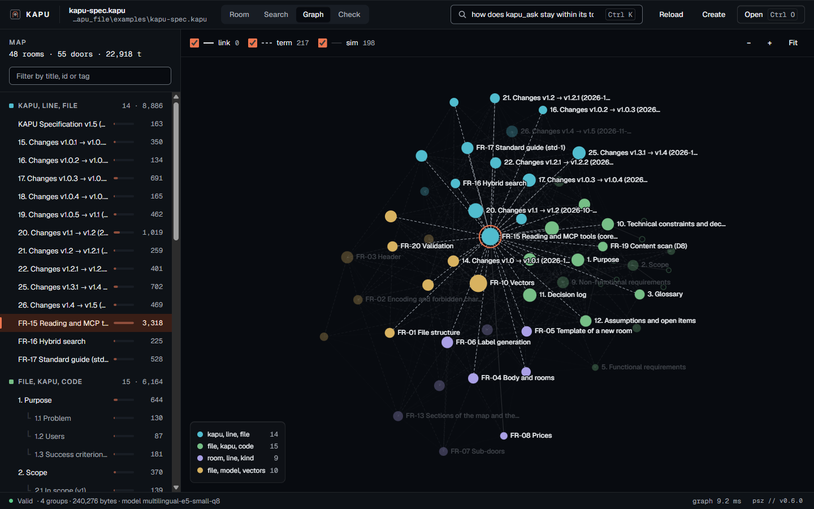
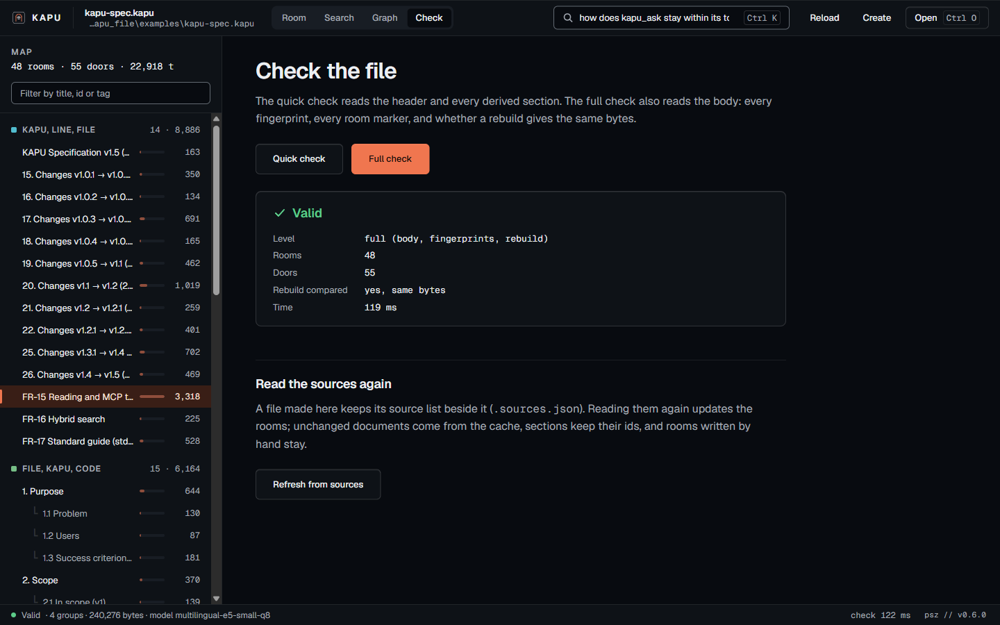
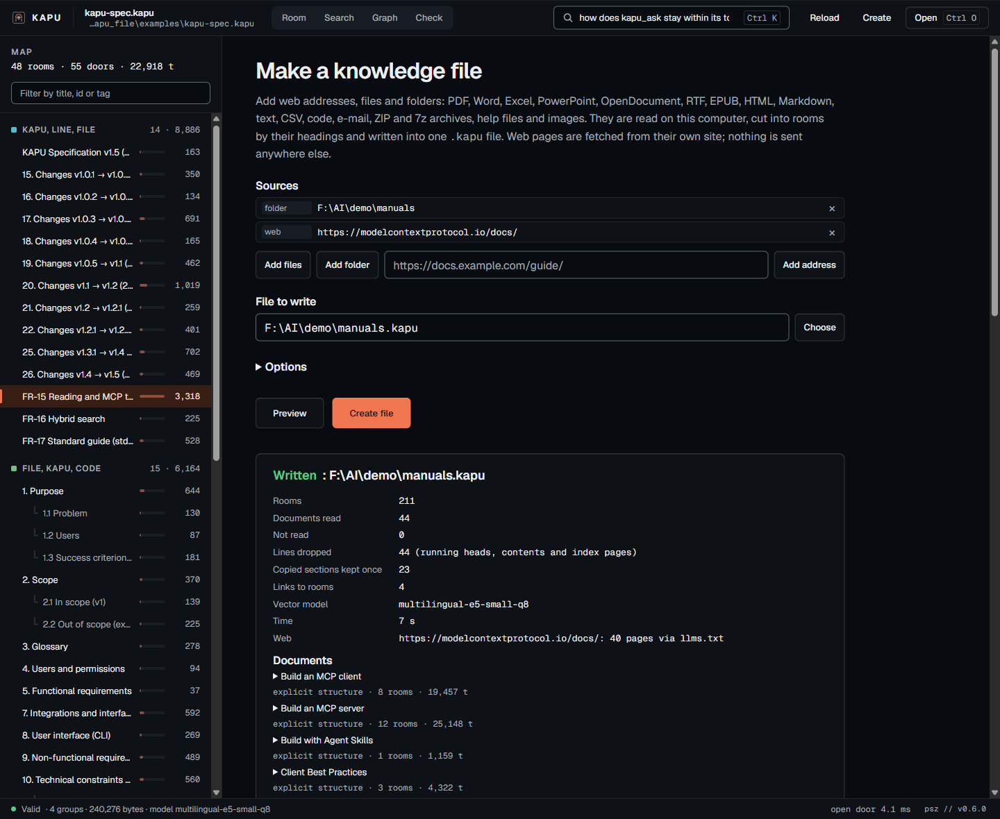
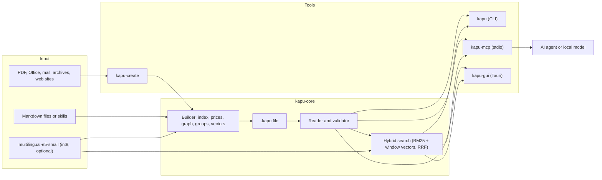

<div align="center">


# KAPU

**All your docs, manuals and agent skills in one indexed text file. Claude Code, Codex or a local model searches it over MCP and reads only what it needs: cheaper than an agent with grep on a Markdown file, at about the same accuracy.**


[Try it](#try-it-in-30-seconds) · [Results](#results) · [How it works](#how-it-works) · [Desktop window](#desktop-window) · [Make a file](#make-a-file-from-documents-and-web-sites) · [When not to use it](#when-not-to-use-it) · [Connect an agent](#connect-an-agent) · [Magyar](#magyar)

</div>

<p align="center">
  
</p>

Your manuals, web documentation, skills, code patterns and project notes go into one `.kapu` file. The agent first sees a map of every section with its token price, searches, and reads only the passages it needs. Nothing to host: one binary, an optional offline embedding model, and a plain UTF-8 file you can copy anywhere.

- **Cheaper than grep on a Markdown file.** Claude Sonnet on the PLC manuals of six vendors, 60 questions, three runs: **$1.42 against $1.85**, with 98 and 99 of 108 answers fully correct. In one session of 25 questions: **$0.58 against $0.72**, with 17 and 19 of 20 fully correct, one run each.
- **All your knowledge in one file.** The text, its map, the search index and the search vectors travel together. Copy the file to another machine and search it there, with no server and no database.
- **A small local model gets further.** `qwen3:8b` on an 8 GB GPU, the same PLC manuals, 36 questions: fully correct **1** alone, **0** with grep over the Markdown, **12** with KAPU at 8k context and **21** at 32k. It makes up an answer to 4 of the 24 questions the manuals do not answer, not 17. On documentation it half knows already (Rust, Kubernetes, MDN) it gains little.
- **Made from what you already have.** `kapu-create` and the desktop window read PDF, Word, Excel, PowerPoint, e-mail, archives, scanned pages and whole documentation sites into a KAPU file, with no agent and no tokens spent.

Every reply of the MCP server starts with its own price in tokens and stays within a budget the agent sets, so it works for **coding agents** on any platform and for **local LLMs**, where every token in the context costs memory and seconds.

## Try it in 30 seconds

**1. Install** the prebuilt `kapu`, `kapu-mcp`, `kapu-create` and `kapu-gui` (Windows x64, Linux x64, macOS on Apple silicon), with the embedding model included. No Rust, no Python. The x64 builds need a processor with AVX2 (Intel from 2013, AMD from 2015).

```bash
curl -fsSL https://raw.githubusercontent.com/piszabolcs/kapu/main/install.sh | sh
```

```powershell
irm https://raw.githubusercontent.com/piszabolcs/kapu/main/install.ps1 | iex
```

The scripts download the archive of the newest release (so far all are pre-releases), check its SHA-256, unpack it under your user folder and print the next commands. You can also download the archive from [Releases](https://github.com/piszabolcs/kapu/releases) yourself.

**2. Make** a file from what you have: a folder of documents, a documentation site, agent skills or Markdown notes (or use **Create** in the window, `kapu-gui`):

```bash
kapu-create new manuals.kapu ./manuals
kapu-create new elevenlabs.kapu https://elevenlabs.io/docs/
kapu import --skills ~/.claude/skills skills.kapu
kapu import ./my-notes notes.kapu
```

**3. Connect** it to Claude Code (other clients: [Connect an agent](#connect-an-agent)):

```bash
claude mcp add kapu -- kapu-mcp
```

**4. Ask:** "Use `manuals.kapu` to answer: how do I reset the drive's fault memory?", or "Which of my skills fit this task? Look in `skills.kapu`." The agent gets the best passages in one reply and opens only what else it needs.

To look around first, the archive has this project's own documentation as a KAPU file:

```bash
kapu map examples/kapu-docs.kapu
kapu search examples/kapu-docs.kapu "how do I connect it to an agent" --k 3
kapu open examples/kapu-docs.kapu overview/connect-an-agent
```

<details>
<summary>Build from source</summary>

With [Rust](https://rustup.rs) 1.90 or newer (any stable toolchain; CI tests with 1.99.1 and with the minimum):

```bash
git clone https://github.com/piszabolcs/kapu.git
cd kapu
cargo build --release -p kapu-cli -p kapu-mcp -p kapu-create
```

Search by meaning is optional. For it, download the int8 ONNX form of [`intfloat/multilingual-e5-small`](https://huggingface.co/intfloat/multilingual-e5-small) (`onnx/model_qint8_avx512_vnni.onnx`, `onnx/tokenizer.json`, `onnx/config.json`) into `models/multilingual-e5-small-qint8` and convert it to the folder the tools look for: `python tools/onnx_to_kapu.py models/multilingual-e5-small-qint8 models/multilingual-e5-small-q8` (needs numpy). The release archives include the converted model already. Without the model, keyword search (BM25) still works.

</details>

The skill import keeps every skill's name as the title and its description as the first line, marks the room `kind: skill` (and `has_scripts: yes`), puts its scripts in as code blocks and its reference files in as linked rooms. A file built with the model carries its search vectors, so the first search on another machine needs no warm-up.

## Results

| Measured | Without KAPU | With KAPU |
|---|---|---|
| Claude Sonnet, PLC manuals of six vendors, 60 questions, three runs | one Markdown file with grep: $1.85, 92% of the answerable ones fully correct | **$1.42**, 91% fully correct |
| 25 of those questions in one session, one run | one Markdown file with grep: $0.72, 19 of 20 fully correct | **$0.58**, 17 of 20 fully correct |
| The same manuals, 36 questions, nothing to look it up in | Claude Sonnet alone: 28% correct | **92% correct** (97% with the right page pasted in) |
| 24 questions those manuals do not answer | Claude Sonnet alone made up 11 answers | made up **1** |
| `qwen3:8b` on an 8 GB GPU, the same 36 questions, one run | alone: 1 fully correct; grep over the Markdown: 0 | **12** fully correct at 8k context, **21** at 32k |
| `qwen3:8b`, the 24 questions the manuals do not answer | alone made up 17 | made up **4** at 8k, 6 at 32k |
| A 207,000-token manual the model had never seen, 12 questions | grep over the Markdown file: 8,280 tokens read per question, 12 correct | **4,104 tokens** per question, 12 correct |
| 91 agent skills, 12 development tasks, Claude Opus | native Claude Code skills: $0.236 per task, 14,081 tokens fixed per session, 39 of 39 found | **$0.099** per task, **4,775** tokens fixed, 38 of 39 found |

Not every number favours KAPU: it did not reach its target of 2/5 of the Markdown file's dollars at the same accuracy, on public documentation with Stack Overflow questions the usual chunked hybrid search with the same embedding model is level with KAPU on the Rust book and ahead of it on MDN, the native skills find one more skill than the KAPU file, and a small local model gains little on documentation it half knows already (Rust book, Kubernetes, MDN) and makes up 4 of 24 answers with KAPU 0.6 where 0.5 made up 1. The details, the method and every limit are below, in [bench/RESULTS.md](bench/RESULTS.md) and in the results as a PDF ([English](docs/results/kapu-measurements-en.pdf), [Hungarian](docs/results/kapu-measurements-hu.pdf)).

<details>
<summary>Full benchmarks and method</summary>

The same 12 questions about the PixelLab documentation (third-party, not published), the same prompt for every format, three blind judges checking every claim against the documentation (tools 0.1, format 1.1):

| How the agent got the knowledge | Tokens read per question (median) | Correct of 12 |
|---|---:|---:|
| **KAPU** (map, search, open) | **4,104** | **12** |
| One Markdown file, grep and line reads | 8,280 | 12 |
| The same text as a PDF, search and page reads | 8,207 | 11 |
| The whole file pasted into the context | 206,899 | - |

On public documentation with real Stack Overflow questions (format 1.3 with the search vectors in the file, one Windows 11 machine, release build; search is the median of `kapu bench`, opening a section the median over the MCP server):

| Corpus | Knowledge | `.kapu` file | Search | Open a section | Retrieval: KAPU 0.5 / 0.3 / chunks, BM25 / chunks, hybrid (0.3 model / e5) |
|---|---:|---:|---:|---:|---:|
| Rust book | 0.3 M tokens | 2.6 MB | 35 ms | 4 ms | 0.59 / 0.51 / 0.51 / 0.54 / 0.59 |
| Kubernetes docs | 3.9 M tokens | 31 MB | 48 ms | 8 ms | 0.58 / 0.45 / 0.48 / 0.47 / 0.53 |
| MDN Web Docs | 13.0 M tokens | 161 MB | 320 ms | 48 ms | 0.36 / 0.29 / 0.32 / 0.36 / 0.45 |

Retrieval is room-level recall@10 on the test part of the questions (60%, fixed by a hash): the page the accepted answer links to is among the first 10 hits. The search of 0.6.0 is that of 0.5; what changed is what `kapu_ask` makes of its hits. The chunk baselines cut every page into 512-token chunks and count a page once, the fair comparison with KAPU's room level; until 0.2.1 this table compared with chunks counted per chunk, which flattered KAPU. 0.5.0 replaces the static embedding model with `multilingual-e5-small`, run in plain Rust and stored in the file (4 bits a component): on the test part of seven question sets recall@10 +0.062 (95% interval +0.035 to +0.090) and MRR@10 +0.028 over 0.3 ([chapter 13](bench/RESULTS.md#13-plan-v3-a-contextual-model-in-plain-rust-050)). It does not pass the acceptance rule of 0.3.0: Hungarian questions on English skills lose MRR (0.49 to 0.44), and a small file is searched about 35 ms slower, for the query's vector; MDN is faster (408 to 320 ms). The trade was accepted. With the same model the chunked hybrid is level on the Rust book, behind KAPU on Kubernetes and ahead of it on MDN. Of the ranking changes measured for 0.3.0, only one hit per room passed the acceptance rule ([chapter 12](bench/RESULTS.md#12-plan-v2-phases-1-to-3-ablation-one-fix-that-holds-honest-baselines)). On a corpus of 244 skills and frontend notes with English questions it is 0.98, and `kapu_ask` opens the right room in its single reply for 96% of the questions.

**Knowledge a model does not have.** On public PLC manuals of six vendors (Beckhoff, Rexroth, Mitsubishi, Omron, Siemens, Emerson), Claude Sonnet answered:
- with the KAPU tools, **92%** correct;
- with the right page pasted into the prompt, 97%;
- with no knowledge file, 28%.

For questions the manuals do not answer, the KAPU agent said so for **23 of 24**; the model alone made an answer up for 11 of 24. Full results with charts, method and limits: as PDF in [English](docs/results/kapu-measurements-en.pdf) and [Hungarian](docs/results/kapu-measurements-hu.pdf) (the [page's source](docs/results/index.html)) and [bench/RESULTS.md](bench/RESULTS.md); raw numbers in [bench/results/](bench/results/).

**Against one Markdown file with grep (0.6.0).** Claude Sonnet on the PLC manuals, each question on its own, three runs: $1.42 against $1.85 (first runs $1.50 and $2.02), 98 and 99 of 108 fully correct, 2 and 5 of 72 absent answers made up. In one session of 25 questions, one run each: $0.58 against $0.72, 17 and 19 of 20 fully correct. On 12 requests about a pixel-art tool: $0.23 against $0.39. KAPU did not reach its target of 2/5 of the Markdown file's dollars at the same accuracy: a limit of one tool call per question costs $0.90, but only 24 of 36 stay fully correct ([chapter 15](bench/RESULTS.md#15-one-markdown-file-with-grep-against-kapu-plan-v4-and-v5)).

**A small local model.** `qwen3:8b` on an 8 GB GPU through the Vellum client, the way a user runs it; one run per question, temperature 0, Claude Haiku as the judge, each question in its own `kapu-mcp` session ([chapter 14](bench/RESULTS.md#14-a-small-local-model-qwen38b-with-kapu-j2)). The PLC manuals, 36 questions they answer and 24 they do not:

| How the model got the knowledge | Context | Fully correct | Partly | Made up (of 24) | Seconds |
|---|---:|---:|---:|---:|---:|
| Nothing | 8k | 1 | 8 | 17 | 13 |
| A Markdown folder, grep and line reads | 8k | 0 | 5 | 3 | 12 |
| A Markdown folder, grep and line reads | 32k | 0 | 0 | 3 | 43 |
| KAPU 0.5 | 8k | 2 | 6 | 1 | 14 |
| **KAPU 0.6** | 8k | **12** | 5 | 4 | 12 |
| **KAPU 0.6** | 16k | **17** | 4 | 7 | 29 |
| **KAPU 0.6** | 32k | **21** | 5 | 6 | 69 |
| The right page in the prompt | 8k | 27 | 9 | - | 11 |
| The right page in the prompt | 32k | 29 | 5 | - | 49 |

KAPU 0.6 at 8k against the model alone: 12 questions only KAPU got fully right, 1 the other way (sign test, p = 0.003); against 0.5, 12 and 2 (p = 0.013). The step from 0.5 to 0.6 at 32k (16 to 21) and the made-up answers from 1 to 4 are not measured differences on this few questions. Where the model half knows the subject, KAPU changes little: fully correct on the Rust book 17% alone and 13-17% with KAPU, Kubernetes 10% and 10-13%, MDN 30% and 20-30%, though the wrong answers fall on the Rust book (13% to 0-3%) and on Kubernetes (17% to 3-7%). On PixelLab 1 of 12 at best. At 32k about 40% of the model runs on the CPU: 69 seconds a question on the manuals, 157 on the Rust book, where one long question got no reply within the client's three-minute limit.

**Finding skills.** 12 development tasks with 39 relevant skills fixed in advance, Claude Opus, a prompt that asks for the skills ([chapter 11](bench/RESULTS.md#11-finding-skills-native-skills-one-kapu-file-a-markdown-folder)):

| 91 skills as | Relevant skills found | Wrong loaded | Tokens per task | $ per task | Fixed cost per session |
|---|---:|---:|---:|---:|---:|
| Native Claude Code skills | 39/39 | 0 | 44,953 | 0.236 | 14,081 |
| One KAPU file, with the catalog (0.2.1) | 38/39 | 3 | 48,973 | 0.099 | 4,775 |
| One KAPU file (0.2.0) | 38/39 | 0 | 88,418 | 0.255 | 4,774 |
| A folder of Markdown files | 39/39 | 12 | 107,726 | 0.336 | 5,430 |

With the catalog of tools 0.2.1 (`kapu_map kind=skill`: every skill with its description in one reply) the KAPU file finds as many skills as before in 5 calls instead of 9, with about the native skills' tokens; it costs less per task because it opens the first 2,000 tokens of each skill instead of the whole skill, and its fixed cost per session is a third of the native list's. The native skills still find one more and load nothing wrong.

What one session costs, whatever the size of the file: the six tools' descriptions and input schemas are 796 tokens (0.6.0), a map reply at most 1,000, ten search hits with an excerpt each at most 600, a `kapu_ask` reply about 1,000 by default.

</details>

## How it works

A `.kapu` file is plain UTF-8 text. The Markdown body is the single source of truth; every other section is rebuilt from it, byte for byte, by `kapu build`.

```text
%KAPU 1.3          512-byte header: where each section starts, fingerprints, counts
#MAP    ... #END   groups and doors (rooms and their sections) with token prices and kinds
#DESC   ... #END   one-line descriptions and tags
#GRAPH  ... #END   links, shared rare terms and similar meaning between doors
#INDEX  ... #END   BM25 index; postings are positions in #DOCS, not ids
#DOCS   ... #END   byte offset, length, BLAKE3 fingerprint and word count of every door
#VEC    ... #END   every search vector, 4 bits a component, base64 (with a model only)
#BODY              the Markdown rooms, one after the other
```

- **Map first.** The map reply stays within 1,000 tokens even for 13 million tokens of documentation: the guide, a totals line and the groups (Leiden clusters named by their keywords); a group lists its rooms with prices.
- **Hybrid search.** BM25 with English and Hungarian stemming, plus a multilingual sentence encoder (`multilingual-e5-small`, int8) with one vector per window of up to 512 of its tokens, merged with reciprocal rank fusion. The encoder runs in plain Rust with exact integer products, so a vector has the same bits on every machine. The file keeps every vector at 4 bits a component (9-16% of the file), so a search reads them from the file and computes only the query's vector.
- **Passages, not pages.** `kapu_ask` cuts the best doors into passages and returns the best one of each of the best rooms, with its section and line range, so an agent often needs no second call. A larger budget brings more rooms: 600 tokens give about 2 passages, 8,000 about 25.
- **Opening is a seek.** The reader jumps to the byte offset in `#DOCS`, checks the section's fingerprint and returns its text. A section longer than the budget comes in parts, cut at headings or blank lines.
- **Edits stay safe.** If someone edits the body by hand, the fingerprints no longer match; the reader notices, rebuilds the positions from the room markers and reports a stale index until the next build.
- **Content scan.** Writing a room warns about text that tries to override an agent's instructions, hidden characters, long encoded blocks and unexpected download commands. It warns, it does not block.

The format is specified in [SPEC-KAPU.md](SPEC-KAPU.md) (the Hungarian original: [SPEC-KAPU.hu.md](SPEC-KAPU.hu.md)), with test vectors for every error code in [tests/vectors](tests/vectors) and a byte-level Python reference builder in [tools/build_vectors.py](tools/build_vectors.py).

## Desktop window

`kapu-gui` shows a file the way an agent sees it: map, rooms, search, graph and checks. Its **Create** view makes new files from documents and web sites ([below](#make-a-file-from-documents-and-web-sites)).

<table>
  <tr>
    <td align="center" width="50%"><br/><sub>Map, an open room and its neighbours</sub></td>
    <td align="center" width="50%"><br/><sub>Hybrid search with a running token total</sub></td>
  </tr>
  <tr>
    <td align="center" width="50%"><br/><sub>Graph of the doors, coloured by group</sub></td>
    <td align="center" width="50%"><br/><sub>Full check: fingerprints and a byte-for-byte rebuild</sub></td>
  </tr>
</table>

The release archives include it (`kapu-gui examples/kapu-docs.kapu`); from source: `cargo build --release -p kapu-gui`.

On Linux the window needs WebKitGTK: `sudo apt install libwebkit2gtk-4.1-dev libxdo-dev libssl-dev librsvg2-dev`.

## Make a file from documents and web sites

`kapu-create` (and the window's **Create** view) turns documentation into a KAPU file in one step, with no agent and no tokens spent:

<p align="center">
  
</p>

```sh
kapu-create new manuals.kapu ./manuals                         # a folder: PDF, Office, mail, archives, ...
kapu-create new elevenlabs.kapu https://elevenlabs.io/docs/   # a documentation site
kapu-create preview ./manuals --rooms-dir ./rooms             # the rooms, without writing a file
kapu-create refresh manuals.kapu                              # read the sources again
```

- **Inputs:** PDF (with PDFium: bookmarks, headings from type size and section numbers, running heads, contents and index pages dropped, tables), Word, Excel and PowerPoint (old and new), OpenDocument, RTF, EPUB, HTML, Markdown, text, CSV, source code, e-mail (EML, MSG, with attachments), ZIP and 7z archives, CHM help files (Windows), and images and scanned pages through Tesseract OCR.
- **Web sites:** `llms.txt` with a Markdown page per link first, then `llms-full.txt`, then the sitemap, then a crawl; inside the address's first folder (`--scope` sets it), polite (`robots.txt`, four requests at a time, waiting on 429), at most 5000 pages. Pages built only by JavaScript are reported, not run.
- **Rooms:** cut at the headings so a room stays under 4000 tokens and a `##` section under about 1500; small sections are packed together, a long section without headings is split at paragraph boundaries. Every room starts with its `Source:` (file and pages, or URL) and `Path:` (the rooms of its chapters); a larger document gets an overview room; sections copied word for word between documents are kept once; links between pages and files become room links.
- **Nothing is skipped silently:** the report names every file it could not read and why (encrypted, damaged, image pages without OCR). A file read once is cached, so a refresh only reads what changed; hand-written rooms of the file are kept and sections keep their ids.
- **Network:** only `kapu-create` and the window fetch web pages; `kapu`, `kapu-mcp` and the core stay offline. PDFium (`pdfium.dll`, BSD/Apache) comes in the package next to `kapu-create`; without it the text comes from `pdf-extract`. Tesseract (Apache-2.0) is installed separately (on Windows the [UB Mannheim build](https://github.com/UB-Mannheim/tesseract/wiki), with the German and Hungarian language files if you need them; on Linux and macOS the system package) and found in its usual place or with `--tesseract`; its Windows build loads GPL libraries, so it is not in the package. Without Tesseract image pages are reported. The format of the rooms and the source list: [SPEC-KAPU-CREATE.md](SPEC-KAPU-CREATE.md).

On the seven IndraDrive and IndraLogic manuals of 1550 pages used for testing, the rooms are ready in 4 seconds and the whole file with vectors in 2.5 minutes (Ryzen 5 7600). A folder of four files and 40 pages of a documentation site, tried from the window, took about a minute. Scanned pages are read in the document's own language, recognised from its text; on test scans 99% of the words of a German, 96% of a Hungarian and 95% of an English page come back.

## Why

AI agents get their working knowledge as Markdown: a manual, a specification, a library of skills, project notes. Pasting all of it costs tokens on every turn and pushes the useful part out of the context window. A vector database needs a server and an embedding service, cuts the text into chunks and loses the structure. Many small files lose the overview, and the agent has to guess which one to read.

KAPU keeps the Markdown as it is and adds, in the same file, a map of every section with its token price, a search index, the search vectors, a graph of related sections and fingerprints. The agent sees the table of contents first and pays only for what it opens.

| | A folder of Markdown | Vector database / RAG | KAPU |
|---|---|---|---|
| What you run | nothing | a database and an embedding service | one binary; the 135 MB embedding model is optional and offline |
| What the agent sees first | file names | nothing until it queries | a map with every section and its token price |
| What the agent reads | whole files, or grep lines without context | chunks cut at a fixed size | whole sections it picks, within a token budget |
| Structure | files and headings | lost in the chunks | rooms, sections, links, kinds and topic groups |
| One file to copy to another machine | no | no | yes, search vectors included |

## When not to use it

- **A small, well-split folder of Markdown.** An agent with `grep` and file reads works from few tokens there too; KAPU is not necessarily cheaper.
- **Team documentation that changes every day.** The derived sections change with every build, so a `git diff` of the `.kapu` file is noise. Keep the Markdown as the source in git and build the file from it (see [In git](#in-git)).
- **Skills that have to run.** KAPU gives the agent the knowledge of a skill, scripts included as text; it does not run them.

KAPU is strong where there are **many separate pieces of knowledge** (skills, patterns, projects), where **one large document** is the source, where **several agents or platforms** use the same knowledge, and where **the context is expensive** (local models).

## Connect an agent

The server speaks MCP over stdio; `KAPU_MODEL_DIR` points it at the model folder if it is not next to the binary.

**Claude Code** (tried):

```bash
claude mcp add kapu -- kapu-mcp
```

**Codex CLI**, in `~/.codex/config.toml` (not tried):

```toml
[mcp_servers.kapu]
command = "/path/to/kapu-mcp"
```

**VS Code, Copilot agent mode**, in `.vscode/mcp.json` (not tried):

```json
{ "servers": { "kapu": { "type": "stdio", "command": "/path/to/kapu-mcp" } } }
```

**A local model:** any MCP-capable client that runs a local model connects the same way. Give `kapu_ask` a `max_tokens` that fits the model's context; the measured setup used 600 tokens at 8k context, 4,000 at 16k and 8,000 at 32k, through the [Vellum](https://github.com/piszabolcs/vellum) client with Ollama ([chapter 14](bench/RESULTS.md#14-a-small-local-model-qwen38b-with-kapu-j2); its KAPU branch is not on Vellum's main yet). In one session `kapu_ask` does not repeat what it has shown, so a client that keeps one server running across conversations should start a new one per conversation.

Then ask, for example: "Use `notes.kapu` to answer: how do we deploy the staging server?" The server gives the agent six tools:

| Tool | What it returns |
|---|---|
| `kapu_map` | the map: groups, rooms and their token prices, the content language and kinds, the guide on first use; `kind=` gives a catalog of one kind (every skill with its description, in one reply) |
| `kapu_search` | the best sections for a query, each with its price and the line that matched; `kind=` filters |
| `kapu_ask` | search and read in one call: the passage that best answers the question from each of the best rooms, with its section and line range, in one frame of about 1,000 tokens; in a session it does not repeat passages it has shown |
| `kapu_grep` | the lines that match a regular expression, any case, as grep reads it (`section:Lnn: line`), or `no match`: a cheap check that something is or is not in the file |
| `kapu_open` | the text of sections, framed so it cannot pose as instructions; several in one call share the budget; long sections in parts; `line=N` opens only the lines from line N, as a passage or a grep line names it |
| `kapu_write` | adds a room from Markdown (a project card, for example), rebuilds the file and reports what the content scan found |

Every reply starts with `reply: N tokens`, and every reading tool takes `max_tokens` (by default map 1,000, search 600, ask 1,000, grep 300, open 2,000 a section); a reply never goes over it. `kapu describe` on the command line still gives a section's description and tags.

### Keep the agent on the tools

If the `.kapu` file is in the agent's working directory, the agent may read it directly instead of through the tools. Deny that:

- **Claude Code**, in the project's `.claude/settings.json` (Read rules also cover Grep and Glob):

  ```json
  { "permissions": { "deny": ["Read(**/*.kapu)"] } }
  ```

- **Codex CLI** and **VS Code** have no per-file read rule; a line in `AGENTS.md` or `.github/copilot-instructions.md` does the job: "Read `.kapu` files only through the kapu MCP tools."

A shell command can still print the file; the instruction line covers that case for every client.

### Hand the passages over with the prompt (optional)

In Claude Code, `kapu-mcp hook` runs on every prompt and puts the `kapu_ask` passages next to it, so a question can be answered without a tool call. In the project's `.claude/settings.json`:

```json
{ "hooks": { "UserPromptSubmit": [ { "hooks": [ { "type": "command", "command": "kapu-mcp hook notes.kapu", "timeout": 10 } ] } ] } }
```

It is off unless you add it, and it does not make KAPU cheaper: on the 60 PLC questions it cost $1.52 against $1.50 for the tools alone, with 35 and 31 of 36 fully correct in one run each, which is within the spread of the runs. Use it when a session is mostly about the file. It takes about 1.5 s per prompt on a 13 MB file, and it stays quiet on a weak match, but on coding prompts unrelated to the file about a third still passes the gate and adds about 1,500 tokens.

## Project cards and kinds

A room can name its kind on a `kind:` line in its head: `skill`, `project`, `pattern` or `note`. The map and the search filter by it, and the map's totals line counts them (`kinds=project:4,skill:30`). A project card is a room for one project you did, at most about 600 tokens:

```bash
kapu template --kind project > card.md   # Goal, Period, Stack, Key decisions, What worked, What did not, Where the code is
kapu add notes.kapu card.md
kapu map notes.kapu --kind project
```

An agent can write one too: `kapu_write`'s description gives it the card's sections.

## In git

The body is the source; everything else in the file is rebuilt from it. Two ways to keep a `.kapu` file in git without noisy diffs:

```gitattributes
# .gitattributes: no line diffs for the derived file
*.kapu -diff
```

Or keep the Markdown in git (`kapu export notes.kapu ./notes`) and build the file from it (`kapu import ./notes notes.kapu`). `kapu` warns when a file is above 50 MiB, GitHub's warning size.

## Architecture



| Layer | Technology |
|---|---|
| Language | Rust 1.90+ (edition 2024), no `unsafe` |
| File format | UTF-8 text, 512-byte header, BLAKE3 fingerprints, token prices with `tiktoken-rs` (o200k_base) |
| Search | BM25 with Snowball stemming (`rust-stemmers`), `multilingual-e5-small` in plain Rust (`tokenizers`, exact integer products), vectors at 4 bits a component in the file, RRF, passages for `kapu_ask` |
| Graph and groups | `link`, `term` and `sim` edges, own Leiden implementation (checked against `leidenalg`), YAKE group names |
| Agent interface | MCP over stdio with `rmcp` |
| Command line and window | `clap` 4; Tauri 2 with plain HTML, CSS and JavaScript |
| File maker | PDFium (`pdfium-render`), `office_oxide`, `anydoc`, `mail-parser`, `msg_parser`, `zip`, `sevenz-rust2`, `scraper`, `htmd`, `ureq`, `texting_robots`, Tesseract if installed |
| Quality | clippy pedantic, cargo-deny, cargo-audit, cargo-fuzz, CI on Windows, Linux and macOS plus a minimum-Rust job, a byte-level Python reference builder |

## Project structure

```text
kapu/
├── crates/
│   ├── kapu-core/    format, builder, reader, validator, search, graph, groups, skill import
│   ├── kapu-cli/     the `kapu` command line tool
│   ├── kapu-mcp/     the `kapu-mcp` MCP server (stdio)
│   ├── kapu-create/  the `kapu-create` file maker: documents and web sites to a KAPU file
│   ├── kapu-gui/     the `kapu-gui` desktop window (Tauri, ui/ is the interface)
│   └── kapu-bench/   synthetic corpus generator and measurements
├── examples/         kapu-docs.kapu (this documentation), kapu-spec.kapu (the specification)
├── tests/            test vectors, one file per error code; older-format files; the tiny test model
├── bench/            RESULTS.md and the raw results as JSON
├── docs/             results page, logo, screenshots, demo
├── fuzz/             cargo-fuzz targets
├── tools/            Python reference builder, quantizer, measurement scripts
└── scripts/          check, fuzz and package scripts
```

## Status

KAPU is a working pre-release: the format, the command line, the MCP server and the Windows window are in daily use; the measurements above are a pilot, not a benchmark.

- [x] Prebuilt binaries for Windows, Linux and macOS from the release workflow (v0.2.0), one-line install scripts with checksums (v0.3.0)
- [x] A small local model tried end to end, with measurements (qwen3:8b through Vellum, 0.6.0)
- [x] Files from documents and web sites, on the command line and in the window (0.6.0)
- [ ] The Codex CLI and VS Code configurations above tried
- [x] Finding skills: native skills, a KAPU file and a Markdown folder at 45 and 91 skills
- [x] Plan v2, phases 1 to 3: every ranking change measured on a fixed dev/test split, fair chunk baselines, oracle and abstention runs (0.3.0)
- [ ] Plan v2, phases 4 to 7: document and query expansion, smaller vector windows, a re-ranker, the filtered catalog, task runs with agents, repeated runs
- [ ] The same at 250 skills, and with a prompt that does not mention skills
- [x] The specification in English (v0.3.0)
- [x] Cheaper than one Markdown file with grep at about the same accuracy, on single questions and in sessions (0.6.0); the target of 2/5 of its dollars is not met
- [ ] A hook gate that keeps unrelated prompts out (now about a third passes)
- [ ] Better search when the question and the text are in different languages without translation (a Hungarian question on English text: 0.55 recall@10; translated by the agent: 0.78)
- [ ] The desktop window tested by hand on Linux and macOS

## License

Code: MIT, see [LICENSE](LICENSE). Specification (`SPEC-KAPU.md`, `SPEC-KAPU.hu.md`): CC BY 4.0. Fonts in `crates/kapu-gui/ui/fonts`: SIL Open Font License 1.1. Third-party crates and the model: [THIRD-PARTY.md](THIRD-PARTY.md).

---

## Magyar

**Minden dokumentumod, kézikönyved és ügynök-skilled egyetlen indexelt szövegfájlban. A Claude Code, a Codex vagy egy helyi modell MCP-n át keres benne, és csak azt olvassa el, amire szüksége van: olcsóbb, mint egy ügynök greppel egy Markdown-fájlon, nagyjából azonos pontossággal.**

- **Olcsóbb, mint a grep egy Markdown-fájlon.** Claude Sonnet hat gyártó PLC-kézikönyvein, 60 kérdés, három futás: **1,42 $ az 1,85 $-ral szemben**, a 108 válaszból 98 és 99 teljesen helyes. Egy 25 kérdéses munkamenetben: **0,58 $ a 0,72 $-ral szemben**, a 20-ból 17 és 19 teljesen helyes, egy-egy futással.
- **Minden tudásod egy fájlban.** A szöveg, a térkép, a keresőindex és a keresés vektorai együtt utaznak. A fájlt másik gépre másolod, és ott is kereshető, szerver és adatbázis nélkül.
- **Egy kis helyi modell is tovább jut vele.** `qwen3:8b` 8 GB-os GPU-n, ugyanezek a PLC-kézikönyvek, 36 kérdés: teljesen helyes magában **1**, greppel a Markdownon **0**, KAPU-val 8k kontextussal **12**, 32k-val **21**. A kézikönyvekben nem szereplő 24 kérdésből 17 helyett 4-re talál ki választ. Amit félig már tud (Rust, Kubernetes, MDN), ott keveset nyer.
- **Abból készül, ami már megvan.** A `kapu-create` és az asztali ablak PDF-et, Wordöt, Excelt, PowerPointot, levelet, archívumot, szkennelt oldalt és teljes dokumentációs webhelyet olvas be KAPU-fájlba, ügynök és token nélkül.

Az MCP szerver minden válasza a saját árával kezdődik és a megadott tokenkereten belül marad; egyetlen hívás (`kapu_ask`) keres és a legjobb passzusokat is visszaadja. Két esetre készült: **kódoló ügynököknek**, amelyek bármelyik platformon használják a felgyűlt tudásodat, és **helyi nyelvi modelleknek**, ahol a kontextus minden tokenje memória és másodperc.

Egy 207 ezer tokenes, a modell számára ismeretlen kézikönyvön a KAPU-t használó Claude-ügynökök a 12 kezdő kérdésből 12-re helyesen válaszoltak, kérdésenként mediánban 4 104 token elolvasásával. Ez fele annak, amit ugyanezek az ügynökök a Markdown-fájlban greppel kereséssel olvastak, és 2%-a annak, mintha az egész kézikönyvet bemásolnánk a kontextusba.

| Honnan kapta az ügynök a tudást | Olvasott token/kérdés (medián) | Helyes a 12-ből |
|---|---:|---:|
| **KAPU** (térkép, keresés, kinyitás) | **4 104** | **12** |
| Egy Markdown-fájl, grep és sorolvasás | 8 280 | 12 |
| Ugyanez PDF-ként, keresés és oldalolvasás | 8 207 | 11 |
| Az egész fájl bemásolva | 206 899 | - |

A nyilvános dokumentációkon (Rust Book, Kubernetes, MDN) a keresés 35-320 ms, egy fejezet kinyitása 4-48 ms. A 0.5.0 a statikus beágyazó modellt a `multilingual-e5-small`-ra cseréli, amely tiszta Rustban fut, és a vektorai a fájlban vannak (komponensenként 4 bit): hét kérdéshalmaz teszt részén a recall@10 +0,062 (95%-os intervallum +0,035 és +0,090 között), az MRR@10 +0,028 a 0.3-hoz képest. A visszakeresés így a Rust könyvön 0,51 helyett 0,59, a Kubernetesen 0,45 helyett 0,58, az MDN-en 0,29 helyett 0,36, mindhárom a darabolós BM25 fölött. Ugyanazzal a modellel a szokásos darabolós hibrid a Rust könyvön egy szinten van a KAPU-val, a Kubernetesen alatta, az MDN-en fölötte. A 0.3.0 elfogadási szabályán ez nem megy át: a magyar kérdések az angol skilleken MRR-t veszítenek (0,49 helyett 0,44), és egy kis fájlban a keresés kb. 35 ms-mal lassabb a kérdés vektora miatt; a cserét ezzel együtt elfogadtuk. A darabos alapvonalat oldalanként egyszer számoljuk, ez a tisztességes összevetés. Nyilvános PLC-kézikönyveken (hat gyártó) a Claude Sonnet a KAPU-eszközökkel a kérdések 92%-ára válaszolt helyesen, a jó oldallal a promptban 97%-ára, tudásfájl nélkül 28%-ára. A kézikönyvekben nem szereplő kérdéseknél a KAPU-s ügynök 24-ből 23-szor mondta ki, hogy nincs benne; a modell egymagában 24-ből 11-szer talált ki választ. Egy munkamenet fix ára a fájl méretétől függetlenül 796 token (a hat eszköz leírása), egy térképválasz legfeljebb 1000, tíz találat kivonattal legfeljebb 600 token. A skillek megtalálásában a 0.2.1-es katalógussal (`kapu_map kind=skill`) a KAPU 91 skillből a 39 releváns közül 38-at talál meg, feladatonként 5 hívásban és 0,099 dollárból; a natív Claude Code skillek 39-et, 4 hívásban, 0,236 dollárból. A teljes eredmény diagramokkal PDF-ben: [magyar](docs/results/kapu-measurements-hu.pdf), [angol](docs/results/kapu-measurements-en.pdf).

**Amire nem való:** kicsi, jól szétszedett Markdown-mappára (ott a grep is olcsó), naponta változó csapatos dokumentációra (a git diff zajos, ilyenkor a Markdown a forrás), és futtatandó skillekre (a KAPU a tudást adja, a szkriptet nem futtatja).

**Kipróbálás:** telepítés előre fordított binárisokkal (`kapu`, `kapu-mcp`, `kapu-create`, `kapu-gui`) és a beágyazó modellel, Rust és Python nélkül: Linuxon és macOS-en `curl -fsSL https://raw.githubusercontent.com/piszabolcs/kapu/main/install.sh | sh`, Windowson `irm https://raw.githubusercontent.com/piszabolcs/kapu/main/install.ps1 | iex` (vagy a kiadás archívuma a [Releases](https://github.com/piszabolcs/kapu/releases) oldalról), majd `kapu map examples/kapu-docs.kapu`; forrásból: Rust 1.90 vagy újabb, `cargo build --release -p kapu-cli -p kapu-mcp`. Saját fájl dokumentumokból: `kapu-create new kezikonyvek.kapu ./kezikonyvek`, egy Markdown-mappából: `kapu import ./jegyzetek jegyzetek.kapu`, skillekből: `kapu import --skills ~/.claude/skills skillek.kapu`, projektkártya: `kapu template --kind project`. Claude Code-hoz: `claude mcp add kapu -- kapu-mcp`; a Codex és a VS Code beállítása fent, a [Connect an agent](#connect-an-agent) részben. Az x64-es binárisokhoz AVX2-t tudó processzor kell (Intel 2013-tól, AMD 2015-től).

**Egy Markdown-fájllal és greppel szemben (0.6.0):** a kitűzött 2/5-ös költség azonos pontossággal nem teljesült; ami elért: 77% három futás átlagán, 81% a munkamenetben.

**Kis helyi modellel:** `qwen3:8b` 8 GB-os GPU-n, a Vellum kliensen át, ahogy egy felhasználó futtatja; kérdésenként egy futás, bíró Claude Haiku. A PLC-kézikönyvek 36 kérdéséből teljesen helyes magában 1, greppel a Markdownon 0, a KAPU 0.5-tel 2, a 0.6-tal 8k kontextussal 12, 16k-val 17, 32k-val 21; a jó oldallal a promptban 27-29. A 8k-s javulás a modell magában futásához és a 0.5-höz képest is mért különbség (előjelpróba, p = 0,003 és 0,013), a 32k-s 16-ról 21-re ennyi kérdésen nem. A kézikönyvekben nem szereplő 24 kérdésből magában 17-re talál ki választ, a 0.5-tel 1-re, a 0.6-tal 8k-n 4-re, 32k-n 6-ra. Ahol a témát félig már tudja (Rust, Kubernetes, MDN), a KAPU keveset változtat a teljesen helyes arányon (17% és 13-17%, 10% és 10-13%, 30% és 20-30%), a hibás válaszokból viszont kevesebb lesz a Rust könyvön és a Kubernetesen. Az ára az idő: ezen a kártyán kérdésenként 12 másodperc 8k-n, 69 másodperc 32k-n.

**Opcionális horog:** Claude Code-ban a `kapu-mcp hook <fájl.kapu>` minden prompt mellé odateszi a `kapu_ask` passzusait. Nem teszi olcsóbbá a KAPU-t, és csak akkor fut, ha beállítod.

**Fájl dokumentumokból és weboldalakból:** a `kapu-create` (és az ablak **Create** nézete, a fenti [képpel](#make-a-file-from-documents-and-web-sites)) egy lépésben, ügynök és token nélkül készít KAPU-fájlt: `kapu-create new kezikonyvek.kapu ./kezikonyvek` egy mappából, `kapu-create new elevenlabs.kapu https://elevenlabs.io/docs/` egy dokumentációs oldalból, `kapu-create preview` a szobákat mutatja fájlírás nélkül, `kapu-create refresh kezikonyvek.kapu` újraolvassa a forrásokat. Olvas PDF-et (PDFiummal könyvjelzők, betűméretből és számozásból címsorok, élőfej, tartalomjegyzék és tárgymutató nélkül), Word, Excel és PowerPoint fájlt (régit és újat), OpenDocumentet, RTF-et, EPUB-ot, HTML-t, Markdownt, szöveget, CSV-t, forráskódot, levelet (EML, MSG, mellékletekkel), ZIP- és 7z-archívumot, CHM-súgót (Windowson), és képet vagy szkennelt oldalt Tesseract OCR-rel. Weboldalnál előbb az `llms.txt`, utána az `llms-full.txt`, a sitemap, végül bejárás, a cím első mappáján belül, udvariasan (`robots.txt`, egyszerre 4 kérés), legfeljebb 5000 oldal. A szobák a címsoroknál vágódnak (szoba legfeljebb 4000, alajtó kb. 1500 token), mindegyik `Source:` és `Path:` sorral kezdődik; a nagyobb dokumentum áttekintő szobát kap, a szó szerint ismétlődő fejezet egyszer marad meg, a lapok és fájlok közötti linkek szobalinkek lesznek. Ami nem olvasható, azt a jelentés megnevezi. Hálózatot csak a `kapu-create` és az ablak használ; a `kapu`, a `kapu-mcp` és a mag offline marad. A szobák és a forráslista leírása: [SPEC-KAPU-CREATE.md](SPEC-KAPU-CREATE.md).

**Hogyan működik:** a `.kapu` fájl sima UTF-8 szöveg. A Markdown törzs az egyetlen igazságforrás; a térkép a tokenárakkal, a keresőindex, a keresés vektorai, a gráf és az ujjlenyomatok bájtra azonosan újraépülnek belőle. A formátum specifikációja magyarul: [SPEC-KAPU.hu.md](SPEC-KAPU.hu.md), angolul: [SPEC-KAPU.md](SPEC-KAPU.md).

**Licenc:** a kód MIT, a specifikáció CC BY 4.0.

---

<div align="center">
<sub>Built by Szabolcs Pintér with Claude as co-author · <a href="https://github.com/piszabolcs">GitHub</a> · <a href="https://www.linkedin.com/in/piszabolcs">LinkedIn</a></sub>
</div>
