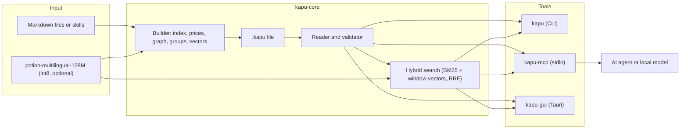

<div align="center">


# KAPU

**A personal knowledge base in a single text file that any MCP-capable agent can search for a few hundred tokens.**


[Results](#results) · [Quickstart](#quickstart) · [Connect an agent](#connect-an-agent) · [When not to use it](#when-not-to-use-it) · [How it works](#how-it-works) · [Magyar](#magyar)

</div>

<p align="center">
  
</p>

Put your skills, code patterns and project notes in one `.kapu` file, and Claude Code, Codex, Copilot or a local model finds the relevant part on its own, without loading the rest. You no longer have to remember which of your 30 skills fits the task, or whether you already built something similar six months ago.

It is built for two cases: **coding agents** that should use your accumulated knowledge on any platform, and **local LLMs**, where every token in the context costs memory and seconds. Every reply of the MCP server starts with its own price in tokens and stays within a budget the agent sets, and one call (`kapu_ask`) can search and open the answer.

> On a 207,000-token manual the model had never seen, Claude agents using KAPU answered **12 of 12** beginner questions while reading **4,104 tokens** per question: **half** of what the same agents read with grep over the Markdown file, and **2%** of pasting the whole manual into the context.

## Results

The same 12 questions about the PixelLab documentation (third-party, not published), the same prompt for every format, three blind judges checking every claim against the documentation (tools 0.1, format 1.1):

| How the agent got the knowledge | Tokens read per question (median) | Correct of 12 |
|---|---:|---:|
| **KAPU** (map, search, open) | **4,104** | **12** |
| One Markdown file, grep and line reads | 8,280 | 12 |
| The same text as a PDF, search and page reads | 8,207 | 11 |
| The whole file pasted into the context | 206,899 | – |

On public documentation with real Stack Overflow questions (format 1.2 with the search vectors in the file, one Windows 11 machine, release build, medians over the MCP server):

| Corpus | Knowledge | `.kapu` file | Search | Open a section | Retrieval: KAPU / chunked BM25 |
|---|---:|---:|---:|---:|---:|
| Rust book | 0.3 M tokens | 2.4 MB | 32 ms | 4 ms | 0.49 / 0.49 |
| Kubernetes docs | 3.9 M tokens | 28 MB | 50 ms | 8 ms | 0.46 / 0.45 |
| MDN Web Docs | 13.0 M tokens | 139 MB | 282 ms | 48 ms | 0.28 / 0.30 |

Retrieval is room-level recall@10: the page the accepted answer links to is among the first 10 hits. On a corpus of 244 skills and frontend notes with 77 English questions it is 0.96, and `kapu_ask` opens the right room in its single reply for 83% of the questions. Full results with charts, method and limits: **[results page](https://piszabolcs.github.io/kapu/results/)** ([source](docs/results/index.html)) and [bench/RESULTS.md](bench/RESULTS.md); raw numbers in [bench/results/](bench/results/).

**Finding skills.** 12 development tasks with 39 relevant skills fixed in advance, Claude Opus, a prompt that asks for the skills ([chapter 11](bench/RESULTS.md#11-finding-skills-native-skills-one-kapu-file-a-markdown-folder)):

| 91 skills as | Relevant skills found | Wrong loaded | Tokens per task | Fixed cost per session |
|---|---:|---:|---:|---:|
| Native Claude Code skills | 39/39 | 0 | 44,953 | 14,081 |
| One KAPU file | 38/39 | 0 | 88,418 | 4,774 |
| A folder of Markdown files | 39/39 | 12 | 107,726 | 5,430 |

With 91 skills the native skills are the better choice for a task that needs them; KAPU costs about twice as much there, but about 9,300 tokens less in every session that needs none, and its cost does not grow with the number of skills.

What one session costs, whatever the size of the file: the six tools' descriptions and input schemas are 797 tokens, a map reply at most 1,000, ten search hits with an excerpt each at most 600 (format 1.2, measured on a 3,000-room file and the corpora above).

## Why

AI agents get their working knowledge as Markdown: a manual, a specification, a library of skills, project notes. Pasting all of it costs tokens on every turn and pushes the useful part out of the context window. A vector database needs a server and an embedding service, cuts the text into chunks and loses the structure. Many small files lose the overview, and the agent has to guess which one to read.

KAPU keeps the Markdown as it is and adds, in the same file, a map of every section with its token price, a search index, the search vectors, a graph of related sections and fingerprints. The agent sees the table of contents first and pays only for what it opens.

| | A folder of Markdown | Vector database / RAG | KAPU |
|---|---|---|---|
| What you run | nothing | a database and an embedding service | one binary; the 124 MB embedding model is optional and offline |
| What the agent sees first | file names | nothing until it queries | a map with every section and its token price |
| What the agent reads | whole files, or grep lines without context | chunks cut at a fixed size | whole sections it picks, within a token budget |
| Structure | files and headings | lost in the chunks | rooms, sections, links, kinds and topic groups |
| One file to copy to another machine | no | no | yes, search vectors included |

## When not to use it

- **A small, well-split folder of Markdown.** An agent with `grep` and file reads works from few tokens there too; KAPU is not necessarily cheaper.
- **Team documentation that changes every day.** The derived sections change with every build, so a `git diff` of the `.kapu` file is noise. Keep the Markdown as the source in git and build the file from it (see [In git](#in-git)).
- **Skills that have to run.** KAPU gives the agent the knowledge of a skill, scripts included as text; it does not run them.

KAPU is strong where there are **many separate pieces of knowledge** (skills, patterns, projects), where **one large document** is the source, where **several agents or platforms** use the same knowledge, and where **the context is expensive** (local models).

## Quickstart

Build from source with [Rust](https://rustup.rs) 1.90 or newer (any stable toolchain; CI tests with 1.99.1 and with the minimum):

```bash
git clone https://github.com/piszabolcs/kapu.git
cd kapu
cargo build --release -p kapu-cli -p kapu-mcp
```

Look around in the example, which is this project's own documentation as a KAPU file:

```bash
target/release/kapu map examples/kapu-docs.kapu
target/release/kapu search examples/kapu-docs.kapu "how do I connect it to an agent" --k 3
target/release/kapu open examples/kapu-docs.kapu overview/connect-an-agent
```

Make your own from a folder of Markdown files (one room per file, `##` headings become sections), or from a folder of agent skills:

```bash
target/release/kapu import ./my-notes notes.kapu
target/release/kapu import --skills ~/.claude/skills skills.kapu
```

The skill import keeps every skill's name as the title and its description as the first line, marks the room `kind: skill` (and `has_scripts: yes`), puts its scripts in as code blocks and its reference files in as linked rooms.

Search by meaning is optional. For it, download [`minishlab/potion-multilingual-128M`](https://huggingface.co/minishlab/potion-multilingual-128M) (`config.json`, `README.md`, `tokenizer.json`, `model.safetensors`) into `models/potion-multilingual-128M` and make the int8 copy the tools look for: `python tools/quantize.py models/potion-multilingual-128M`. A file built with the model carries its search vectors, so the first search on another machine needs no warm-up; the reader still needs the model to embed the query. Without it, keyword search (BM25) still works.

## Connect an agent

The server speaks MCP over stdio; `KAPU_MODEL_DIR` points it at the model folder if it is not next to the binary.

**Claude Code** (tried):

```bash
claude mcp add kapu -- /path/to/kapu-mcp
```

**Codex CLI**, in `~/.codex/config.toml` (not tried):

```toml
[mcp_servers.kapu]
command = "/path/to/kapu-mcp"
```

**VS Code, Copilot agent mode**, in `.vscode/mcp.json` (not tried):

```json
{ "servers": { "kapu": { "type": "stdio", "command": "/path/to/kapu-mcp" } } }
```

**A local model:** any MCP-capable client that runs a local model connects the same way. Give `kapu_ask` a `max_tokens` that fits the model's context. A measured setup is still to come.

Then ask, for example: "Use `notes.kapu` to answer: how do we deploy the staging server?" The server gives the agent six tools:

| Tool | What it returns |
|---|---|
| `kapu_map` | the map: groups, rooms and their token prices, the content language and kinds, the guide on first use; `kind=` lists the rooms of one kind |
| `kapu_search` | the best sections for a query, each with its price and the line that matched; `kind=` filters |
| `kapu_ask` | search and open in one call: the best section's text, more whole sections if they fit, and the other matches |
| `kapu_describe` | the description and tags of a section, without opening it |
| `kapu_open` | the text of a section, framed so it cannot pose as instructions; long sections in parts |
| `kapu_write` | adds a room from Markdown (a project card, for example), rebuilds the file and reports what the content scan found |

Every reply starts with `reply: N tokens`, and every reading tool takes `max_tokens` (map 1,000, search 600, the others 2,000 by default); a reply never goes over it.

### Keep the agent on the tools

If the `.kapu` file is in the agent's working directory, the agent may read it directly instead of through the tools. Deny that:

- **Claude Code**, in the project's `.claude/settings.json` (Read rules also cover Grep and Glob):

  ```json
  { "permissions": { "deny": ["Read(**/*.kapu)"] } }
  ```

- **Codex CLI** and **VS Code** have no per-file read rule; a line in `AGENTS.md` or `.github/copilot-instructions.md` does the job: "Read `.kapu` files only through the kapu MCP tools."

A shell command can still print the file; the instruction line covers that case for every client.

## Project cards and kinds

A room can name its kind on a `kind:` line in its head: `skill`, `project`, `pattern` or `note`. The map and the search filter by it, and the map's totals line counts them (`kinds=project:4,skill:30`). A project card is a room for one project you did, at most about 600 tokens:

```bash
target/release/kapu template --kind project > card.md   # Goal, Period, Stack, Key decisions, What worked, What did not, Where the code is
target/release/kapu add notes.kapu card.md
target/release/kapu map notes.kapu --kind project
```

An agent can write one too: `kapu_write`'s description gives it the card's sections.

## In git

The body is the source; everything else in the file is rebuilt from it. Two ways to keep a `.kapu` file in git without noisy diffs:

```gitattributes
# .gitattributes: no line diffs for the derived file
*.kapu -diff
```

Or keep the Markdown in git (`kapu export notes.kapu ./notes`) and build the file from it (`kapu import ./notes notes.kapu`). `kapu` warns when a file is above 50 MiB, GitHub's warning size.

## How it works

A `.kapu` file is plain UTF-8 text. The Markdown body is the single source of truth; every other section is rebuilt from it, byte for byte, by `kapu build`.

```text
%KAPU 1.2          512-byte header: where each section starts, fingerprints, counts
#MAP    ... #END   groups and doors (rooms and their sections) with token prices and kinds
#DESC   ... #END   one-line descriptions and tags
#GRAPH  ... #END   links, shared rare terms and similar meaning between doors
#INDEX  ... #END   BM25 index; postings are positions in #DOCS, not ids
#DOCS   ... #END   byte offset, length, BLAKE3 fingerprint and word count of every door
#VEC    ... #END   the sign bits of every search vector, base64 (with a model only)
#BODY              the Markdown rooms, one after the other
```

- **Map first.** The map reply stays within 1,000 tokens even for 13 million tokens of documentation: the guide, a totals line and the groups (Leiden clusters named by their keywords); a group lists its rooms with prices.
- **Hybrid search.** BM25 with English and Hungarian stemming, plus a static multilingual embedding model with one vector per 512-token window of a section, merged with reciprocal rank fusion. The file keeps one sign bit per vector component (2-3% of the file); those pick 200 candidates, and the model's float vectors order them.
- **Opening is a seek.** The reader jumps to the byte offset in `#DOCS`, checks the section's fingerprint and returns its text. A section longer than the budget comes in parts, cut at headings or blank lines.
- **Edits stay safe.** If someone edits the body by hand, the fingerprints no longer match; the reader notices, rebuilds the positions from the room markers and reports a stale index until the next build.
- **Content scan.** Writing a room warns about text that tries to override an agent's instructions, hidden characters, long encoded blocks and unexpected download commands. It warns, it does not block.

The format is specified in [SPEC-KAPU.md](SPEC-KAPU.md) (in Hungarian for now), with test vectors for every error code in [tests/vectors](tests/vectors) and a byte-level Python reference builder in [tools/build_vectors.py](tools/build_vectors.py).

## Desktop window

`kapu-gui` shows a file the way an agent sees it: map, rooms, search, graph and checks.

<table>
  <tr>
    <td align="center" width="50%"><br/><sub>Map, an open room and its neighbours</sub></td>
    <td align="center" width="50%"><br/><sub>Hybrid search with a running token total</sub></td>
  </tr>
  <tr>
    <td align="center" width="50%"><br/><sub>Graph of the doors, coloured by group</sub></td>
    <td align="center" width="50%"><br/><sub>Full check: fingerprints and a byte-for-byte rebuild</sub></td>
  </tr>
</table>

```bash
cargo build --release -p kapu-gui
target/release/kapu-gui examples/kapu-docs.kapu
```

On Linux the window needs WebKitGTK: `sudo apt install libwebkit2gtk-4.1-dev libxdo-dev libssl-dev librsvg2-dev`.

## Architecture



| Layer | Technology |
|---|---|
| Language | Rust 1.90+ (edition 2024), no `unsafe` |
| File format | UTF-8 text, 512-byte header, BLAKE3 fingerprints, token prices with `tiktoken-rs` (o200k_base) |
| Search | BM25 with Snowball stemming (`rust-stemmers`), Model2Vec static embeddings (`tokenizers`, safetensors), sign-bit vectors with float rescoring, RRF |
| Graph and groups | `link`, `term` and `sim` edges, own Leiden implementation (checked against `leidenalg`), YAKE group names |
| Agent interface | MCP over stdio with `rmcp` |
| Command line and window | `clap` 4; Tauri 2 with plain HTML, CSS and JavaScript |
| Quality | clippy pedantic, cargo-deny, cargo-audit, cargo-fuzz, CI on Windows, Linux and macOS plus a minimum-Rust job, a byte-level Python reference builder |

## Project structure

```text
kapu/
├── crates/
│   ├── kapu-core/    format, builder, reader, validator, search, graph, groups, skill import
│   ├── kapu-cli/     the `kapu` command line tool
│   ├── kapu-mcp/     the `kapu-mcp` MCP server (stdio)
│   ├── kapu-gui/     the `kapu-gui` desktop window (Tauri, ui/ is the interface)
│   └── kapu-bench/   synthetic corpus generator and measurements
├── examples/         kapu-docs.kapu (this documentation), kapu-spec.kapu (the specification)
├── tests/            test vectors, one file per error code; older-format files; the tiny test model
├── bench/            RESULTS.md and the raw results as JSON
├── docs/             results page, logo, screenshots, demo
├── fuzz/             cargo-fuzz targets
├── tools/            Python reference builder, quantizer, measurement scripts
└── scripts/          check, fuzz and package scripts
```

## Status

KAPU is a working pre-release: the format, the command line, the MCP server and the Windows window are in daily use; the measurements above are a pilot, not a benchmark.

- [x] Prebuilt binaries for Windows, Linux and macOS from the release workflow (v0.2.0)
- [ ] A local model tried end to end, with measurements (the Codex CLI and VS Code configurations above stay untried)
- [x] Finding skills: native skills, a KAPU file and a Markdown folder at 45 and 91 skills
- [ ] The same at 250 skills, and with a prompt that does not mention skills
- [ ] The specification in English
- [ ] Better search when the question and the text are in different languages without translation (a Hungarian question on English text: 0.55 recall@10; translated by the agent: 0.78)
- [ ] The desktop window tested by hand on Linux and macOS

## License

Code: MIT, see [LICENSE](LICENSE). Specification (`SPEC-KAPU.md`): CC BY 4.0. Fonts in `crates/kapu-gui/ui/fonts`: SIL Open Font License 1.1. Third-party crates and the model: [THIRD-PARTY.md](THIRD-PARTY.md).

---

## Magyar

**Személyes tudásbázis egyetlen szövegfájlban, amelyben bármely MCP-képes ügynök néhány száz tokenből keres.**

A skilljeid, kódmintáid és projektjegyzeteid egy `.kapu` fájlba kerülnek, és a Claude Code, a Codex, a Copilot vagy egy helyi modell magától megtalálja a hozzá illő részt, a többit nem tölti be. Két esetre készült: **kódoló ügynököknek**, amelyek bármelyik platformon használják a felgyűlt tudásodat, és **helyi nyelvi modelleknek**, ahol a kontextus minden tokenje memória és másodperc. Az MCP szerver minden válasza a saját árával kezdődik és a megadott tokenkereten belül marad; egyetlen hívás (`kapu_ask`) keres és ki is nyitja a választ.

Egy 207 ezer tokenes, a modell számára ismeretlen kézikönyvön a KAPU-t használó Claude-ügynökök a 12 kezdő kérdésből 12-re helyesen válaszoltak, kérdésenként mediánban 4 104 token elolvasásával. Ez fele annak, amit ugyanezek az ügynökök a Markdown-fájlban greppel kereséssel olvastak, és 2%-a annak, mintha az egész kézikönyvet bemásolnánk a kontextusba.

| Honnan kapta az ügynök a tudást | Olvasott token/kérdés (medián) | Helyes a 12-ből |
|---|---:|---:|
| **KAPU** (térkép, keresés, kinyitás) | **4 104** | **12** |
| Egy Markdown-fájl, grep és sorolvasás | 8 280 | 12 |
| Ugyanez PDF-ként, keresés és oldalolvasás | 8 207 | 11 |
| Az egész fájl bemásolva | 206 899 | – |

A nyilvános dokumentációkon (Rust Book, Kubernetes, MDN) a keresés 32–282 ms, egy fejezet kinyitása 4–48 ms; a visszakeresés a két kisebb korpuszon a darabolós BM25 szintjén vagy fölötte van, a legnagyobbon kicsit alatta. Egy munkamenet fix ára a fájl méretétől függetlenül 797 token (a hat eszköz leírása), egy térképválasz legfeljebb 1000, tíz találat kivonattal legfeljebb 600 token. A teljes eredmény diagramokkal, angolul és magyarul: **[eredményoldal](https://piszabolcs.github.io/kapu/results/)**.

**Amire nem való:** kicsi, jól szétszedett Markdown-mappára (ott a grep is olcsó), naponta változó csapatos dokumentációra (a git diff zajos, ilyenkor a Markdown a forrás), és futtatandó skillekre (a KAPU a tudást adja, a szkriptet nem futtatja).

**Kipróbálás:** Rust 1.90 vagy újabb, `cargo build --release -p kapu-cli -p kapu-mcp`, majd `target/release/kapu map examples/kapu-docs.kapu`. Saját fájl egy Markdown-mappából: `kapu import ./jegyzetek jegyzetek.kapu`, skillekből: `kapu import --skills ~/.claude/skills skillek.kapu`, projektkártya: `kapu template --kind project`. Claude Code-hoz: `claude mcp add kapu -- /path/to/kapu-mcp`; a Codex és a VS Code beállítása fent, a [Connect an agent](#connect-an-agent) részben.

**Hogyan működik:** a `.kapu` fájl sima UTF-8 szöveg. A Markdown törzs az egyetlen igazságforrás; a térkép a tokenárakkal, a keresőindex, a keresés vektorai, a gráf és az ujjlenyomatok bájtra azonosan újraépülnek belőle. A formátum specifikációja: [SPEC-KAPU.md](SPEC-KAPU.md).

**Licenc:** a kód MIT, a specifikáció CC BY 4.0.

---

<div align="center">
<sub>Built by Szabolcs Pintér with Claude as co-author · <a href="https://github.com/piszabolcs">GitHub</a> · <a href="https://www.linkedin.com/in/piszabolcs">LinkedIn</a></sub>
</div>
